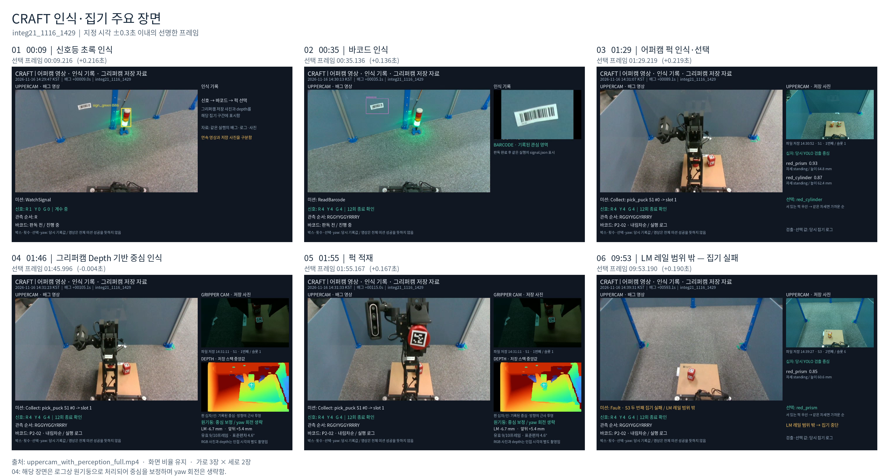

# CRAFT — 주사위 기억 자율주행 로봇

**A팀 크래프트 · ROS 2 Lyrical · Jetson Orin Nano Super · C++17 · OpenCR**

신호등의 점멸 순서를 기억하고 바코드 조건을 해석해, 퍽 12개를 세 장소의 주사위 눈 모양으로 옮기는 로봇 프로젝트입니다. 카메라·라이다 인지부터 미션 판단, 주행, 로봇 팔과 그리퍼 제어, 음성 안내까지 ROS 2 패키지로 구성합니다.

[설치·실행](#처음-실행-시) · [시스템 설계](project2/docs/architecture.md) · [개발 시험 보고서](project2/docs/report.md) · [프로젝트 자료](project2/README.md) · [팀 기여](project2/docs/contributions.md)



2026-11-16 개발 시험의 여섯 장면입니다. 그리퍼캠 장면은 저장된 컬러·깊이 자료로 구성한 설명 화면입니다. 장면별 출처와 해석 범위는 [개발 시험 보고서](project2/docs/report.md)에 정리했습니다.

## 미션

미로의 시작 박스 S1~S6에 놓인 퍽을 수집하고, 신호와 바코드로 정한 조건에 따라 L1~L3에 배치하는 것이 목표입니다.

1. **신호 기억** — 빨강·노랑·초록 신호의 12회 점멸 순서와 횟수를 기록합니다.
2. **조건 해석** — 바코드로 색상 그룹의 정렬 조건을 정합니다.
3. **수집·적재** — 여섯 시작 박스를 방문해 퍽을 집고 회전 적재함인 클락에 싣습니다.
4. **주사위 배치** — 퍽의 색상·모양 조건에 맞춰 세 장소에 배치합니다.
5. **배치 재검증** — 새 카메라 관측으로 실제 배치가 맞는지 확인합니다.
6. **복귀** — 출발 구역으로 돌아와 3초간 정지합니다.

위 순서는 **목표 미션**입니다. 현재 기본 설정은 주행 확인용 `drive_only: true`이며, 퍽 조사(`ObservePucks`)·목적지 배치(`PlacePuck`)·배치 재검증(`VerifyLocation`)은 미구현입니다. `drive_only`를 `false`로 바꾸는 것만으로 전체 미션이 완성되지는 않습니다. [구현 범위와 상태 전이](project2/docs/architecture.md#현재-상태-전이와-완료-조건)

## 시스템 구성

| 계층 | 하는 일 | 주요 패키지·실행파일 |
| --- | --- | --- |
| 센서 | 어퍼캠·그리퍼캠 입력, 전후방 라이다 스캔과 박스 관측 | `craft_sensors`, `lidar_processor` |
| 인지 | 신호등·바코드·퍽 인식, 깊이와 방향 계산, 장애물 검출 | `craft_perception` / `perception_master` |
| 미션 | 신호·바코드 처리와 수집·운반 단계 진행, 실패 처리 | `craft_planning` / `mission_master` |
| 계획·집기 | 주행 경로·팔 목표 계산, 카메라 보정과 집기 단계 실행 | `planning_master`, `puck_picker`, `puck_execute` |
| 제어 | 바퀴·팔·그리퍼·클락 제어, OpenCR 통신과 작업 결과 보고 | `craft_control` / `control_master` |
| 음성 | 상태에 따른 안내, 카메라·인식 결과를 활용한 주변 설명과 질문 응답 | `craft_voice` / 별도 실행 |

### 인지와 주행

- **카메라 역할 분담:** 어퍼캠으로 신호등·바코드와 퍽의 종류·대략적인 위치를 보고, 그리퍼캠으로 근거리 퍽의 깊이 기반 중심과 프리즘 방향을 보정합니다.
- **물체 인식:** YOLO(욜로) 계열 모델을 사용하며 ncnn(엔씨엔엔)·TensorRT(텐서알티) 추론 경로를 포함합니다. 같은 장치용 엔진과 다른 GPU에서의 호환성은 구분해야 합니다.
- **위치 추정:** SLAM(슬램)으로 지도를 만들거나, 저장된 지도에서 AMCL(에이엠씨엘)로 현재 위치를 찾습니다. 통합 실행 인자로 방식을 선택합니다.
- **경로 추종과 접근:** 장애물을 고려한 경로 계획과 Pure Pursuit(퓨어 퍼슈트) 추종을 사용하고, 라이다·카메라 관측을 이용해 박스 앞 접근을 처리합니다.

### 조작과 음성

- **집기:** 티칭한 자세와 카메라 보정값을 바탕으로 관측 자세 → 준비 자세 → 잡기 자세 → 들기 자세 → 클락 적재를 수행합니다. LM(엘엠) 레일의 도달 범위를 벗어나면 집기를 중단합니다.
- **작업 결과:** 계획·제어 사이에서 작업 명령과 완료·실패 결과를 주고받습니다. 제어 오류와 집기 실패는 미션 중단으로 연결됩니다.
- **음성 안내:** 로봇 상태 안내와 주변 설명·질문 응답을 제공합니다. 상태 안내용 고정 문장과 GPT 기반 설명을 구분하며, 음성 기능은 [별도 설정·실행](src/craft_voice/README.md)이 필요합니다.

[노드·토픽·좌표계 상세](project2/docs/architecture.md) · [계획](src/craft_planning/README.md) · [인지](src/craft_perception/README.md) · [제어](src/craft_control/README.md)

## 로봇 구성

| 구성 | 역할 |
| --- | --- |
| Jetson Orin Nano Super | ROS 2 노드와 영상 인식·계획 실행 |
| 어퍼캠·RealSense D435 그리퍼캠 | 넓은 범위의 대상 탐색과 집기 직전 근거리 보정 |
| 전후방 LDS-03 라이다 | 주변 스캔, 지도·위치 추정, 장애물과 박스 관측 |
| 바퀴·로봇 팔·LM 레일·그리퍼 | 이동, 손 위치 보정, 퍽 집기 |
| 클락 | 수집한 퍽을 슬롯에 보관하는 회전 적재함 |
| OpenCR 두 대 | `wheel_clock`: 바퀴·클락 / `lm_arm`: LM·팔·그리퍼 |

[로봇 모델](src/craft_description/README_KO.md) · [펌웨어](firmware/README.md) · [USB 배선·장치 별칭](config/udev/README.md)

## 개발 시험 결과

**2026-11-16 실물 개발 시험 기록 기준이며, 공식 경기 성적이나 전체 미션 완주 결과가 아닙니다.**

| 항목 | 기록에서 확인한 결과 |
| --- | --- |
| 신호 처리 | 12회 결과 `RGGYYGGYRRRY`, R4·Y4·G4 및 종료 이벤트 저장 |
| 바코드 처리 | `P2-02` / `descending` 저장 후 수집 단계 진입 |
| 집기 | 6회 시도 중 5회 완료 로그, 6번째인 S3 두 번째 퍽에서 실패 |
| 중단 원인 | 목표가 LM 레일 범위를 벗어나 수집 단계에서 오류 상태로 전환 |
| 목적지 배치·새 관측 검증·복귀 | 해당 실행에 성공 근거 없음 |

신호·바코드는 독립 정답과 대조하지 않아 인식 정확도를 산출하지 않았습니다. 집기 완료 로그는 적재 슬롯을 새로 촬영해 확인한 결과와 구분합니다. 레일 범위 초과의 근본 원인은 기구 한계·도킹 오차·보정값을 추가 대조해야 합니다.

[시험 결과와 한계](project2/docs/report.md) · [집기별 기록](project2/results/development/integ21_1116_1429/pick-results.csv) · [전체 시험 목록](project2/results/test-results.csv)

## 설치와 실행

기준 환경은 **Jetson Orin Nano Super / Ubuntu 24.04.4 / ROS 2 Lyrical**입니다. 아래쪽에 OS 설치부터 의존성·모델·USB 설정·전체 빌드·미션 실행까지 기존 안내 전문을 이어서 정리했습니다.

[처음 설치하기](#처음-실행-시) · [설치 후 실행하기](#8-실행) · [설치본 아카이브](#설치본-아카이브-생성) · [home 복귀](#home-복귀-명령)

## 저장소 구성

```text
pa_craft/
├── src/
│   ├── craft_bringup/       # 통합 실행·대시보드·시각화
│   ├── craft_interfaces/    # 계획·제어 작업 메시지
│   ├── craft_sensors/       # 카메라·박스 관측·집기 카메라 도구
│   ├── lidar_processor/     # 전후방 라이다 처리
│   ├── craft_perception/    # 영상·라이다 인지와 모델
│   ├── craft_planning/      # 미션·경로·팔 계획·집기 실행
│   ├── craft_control/       # 주행·팔·그리퍼·클락 제어
│   ├── craft_description/   # 로봇 모델·메시
│   └── craft_voice/         # 음성 안내·질문 응답
├── firmware/               # OpenCR 펌웨어·공통 모터 라이브러리
├── config/udev/            # USB 배선에 따른 장치 별칭
├── demo/                   # 집기·주행·시뮬레이션과 참조 구현
├── tools/                  # 빌드·카메라·보정·진단 도구
├── test/                   # 센서·주행 등 검증 자료
├── project2/               # 문제 예제·시스템 설계·개발 시험·팀 기여
└── docs/                   # 설치·배포·운영 안내
```

외부 라이다 드라이버는 `craft.repos`로 받습니다. `src/craft_planning/v75_ws`는 팔 모델·참조 구현 보관용이며 별도 운영 워크스페이스로 빌드하지 않습니다. 빌드 산출물, 촬영 원본, 실행 기록과 비밀 환경 파일은 소스 배포 대상에서 제외합니다.

## A팀 크래프트

| 이름 | 주요 담당 |
| --- | --- |
| 최성진 | 기구 설계·출력·센서 배치, 로봇 모델, 음성 안내 |
| 한지훈 | 라이다·영상 인지, 모델 학습, 카메라 보정, 집기·주행 시험 |
| 박준명 | 시스템 구조, 인지 통합, 경로 계획·도킹·제어 |
| 심규진 | 신호 데이터 보강, 인지 모듈·추론 통합, 주행·팔 공동 시험 |

공동 작업을 포함한 역할 요약입니다. [개인별 작업과 검증 근거](project2/docs/contributions.md)

## 용어

- **YOLO:** 카메라 사진에서 퍽이나 신호등이 어디 있는지 찾는 모델입니다.
- **ncnn·TensorRT:** 학습된 인식 모델을 장치에서 실행하는 도구입니다.
- **SLAM·AMCL:** 주변을 보며 지도를 만들거나, 이미 있는 지도에서 로봇의 위치를 찾는 방법입니다.
- **Pure Pursuit:** 경로 위의 조금 앞 지점을 바라보며 따라가는 주행 방법입니다.
- **LM 레일:** 손 위치를 옆으로 옮기는 직선 이동 장치입니다.

---

## 패키지 및 노드 구성

| 패키지 | 주요 실행파일 및 역할 |
| --- | --- |
| `craft_interfaces` | 계획·제어 간 작업 명령, 결과 및 상태 메시지를 제공합니다. |
| `craft_sensors` | `realsense_processor`: 그리퍼 카메라 입력, `uppercam_bridge`: 어퍼캠·LiDAR 박스 관측을 제공합니다. |
| `lidar_processor` | `lidar_processor`: 전후방 스캔을 처리합니다. `coin_d4_driver`는 외부 소스 의존성입니다. |
| `craft_perception` | `perception_master`: 물체·퍽·신호등·바코드 및 LiDAR 인지를 담당합니다. |
| `craft_planning` | `planning_master`: 주행·팔 작업 계획, `mission_master`: 미션 진행, `puck_picker`: 집기 요청 연결, `puck_execute`: 보정된 집기 단계 실행을 담당합니다. `dice_demo`도 포함합니다. |
| `craft_control` | `control_master`: 주행·팔·그리퍼·클락 제어 및 펌웨어 통신을 담당합니다. |
| `craft_description` | 로봇 URDF 및 메시를 제공합니다. |
| `craft_bringup` | 통합 launch, 대시보드, `global_localize`, `odom_trail`, `box_marker`, `puck_marker`를 제공합니다. |

`src/craft_planning/v75_ws`는 팔 모델과 참조 구현을 보관하는 디렉터리입니다. 별도 운영 워크스페이스로 빌드하지 않습니다.

## 함께 제공되는 자료

프로젝트 2의 문제·설계·시험·개인별 기여와 보고서 이미지는 [프로젝트 2 제출 자료](project2/README.md)에 정리했습니다. 공식 회차 등 미확인 증빙은 별도로 표시했습니다.

- `firmware/`: OpenCR 펌웨어와 공통 모터 라이브러리입니다.
- `demo/puck_pick/`: 티칭·집기 설정, Python 참조 구현 및 인수인계 자료입니다.
- `tools/realsense_check/`: `grip_yaw`, `upper_puck` 카메라 실행파일과 보정 파일입니다. 카메라 도구는 `craft_sensors`에서 함께 빌드·설치하며, 독립 CMake 빌드는 소스 실험용으로 유지합니다.
- `src/craft_perception/models/`: ncnn·ONNX 모델 및 현재 장치용 TensorRT 엔진입니다. 다른 GPU 또는 TensorRT 버전에서는 ONNX로 엔진을 다시 생성해야 합니다.
- `demo/driving_sim/`, `demo/mission_sim/`, `test/`: 시뮬레이션 및 검증 자료입니다.

빌드 산출물, 촬영 데이터, 실행 기록, 로컬 환경 파일 및 백업 사본은 배포 대상에서 제외합니다. 티칭 및 보정 원본은 포함합니다.

## 처음 실행 시

현재 로봇과 같은 Jetson Orin Nano Super, USB 배선, 카메라 및 OpenCR을 사용하는 경우의 설치 순서입니다. 아래 명령은 Jetson에서 일반 사용자로 실행합니다. 계정명은 기존 소스 실험 도구와의 호환을 위해 `craft`, 저장소 위치는 `~/craft`를 사용합니다. 각 단계가 성공한 뒤 다음 단계로 진행해 주십시오.

### 1. Jetson OS와 개발 환경 설치

2026-11-17에 기존 장치에서 확인한 환경입니다.

| 항목 | 기준 |
| --- | --- |
| 장치 / 아키텍처 | Jetson Orin Nano Super / aarch64 |
| OS / Jetson Linux | Ubuntu 24.04.4 / L4T 39.2.1 |
| JetPack | 7.2.1 계열: L4T·CUDA·TensorRT 버전으로 확인 |
| CUDA / TensorRT | 13.2.2 / 10.16.2.10 |
| ROS 2 | Lyrical, NVIDIA Isaac ROS Buildfarm의 Noble 패키지 |
| Pinocchio / coal | 4.1.0 / 3.0.3 |
| librealsense | 2.57.7, CUDA 활성화, Orin SM 87 |
| ncnn | 20261024, 아래 커밋으로 빌드 |
| ZXing | 2.2.1 |

1. 별도 PC에서 [NVIDIA JetPack 다운로드](https://developer.nvidia.com/embedded/jetpack/downloads)의 **7.2.1 Jetson ISO**를 받아 설치 USB를 만듭니다. ISO를 로봇의 대상 SSD에 직접 쓰는 대신 USB로 부팅하여 대상 저장장치에 설치합니다.
2. Jetson에 모니터·키보드·설치 USB를 연결하고, 부팅 메뉴에서 USB를 선택하여 Jetson Linux를 설치합니다. UEFI/QSPI가 오래된 장치의 선행 업데이트와 설치 화면은 [Orin Nano 공식 설치 안내](https://docs.nvidia.com/jetson/orin-nano-devkit/user-guide/latest/quick_start.html)를 따릅니다. 대상 저장장치를 선택하면 기존 내용이 지워집니다.
3. 사용자 `craft`를 만들고 네트워크를 연결합니다. JetPack 개발 구성요소(CUDA·TensorRT 포함)를 설치합니다. 아래 명령은 **L4T 39.2.1용 NVIDIA 저장소가 설정된 환경**에서 실행합니다. 다른 릴리스로 무조건 업그레이드하지 말고 설치 후보를 확인합니다.

```bash
cat /etc/os-release
cat /etc/nv_tegra_release
uname -m
sudo apt update
apt-cache policy nvidia-jetpack cuda-toolkit-13-2 libnvinfer10
sudo apt install -y nvidia-jetpack
/usr/local/cuda/bin/nvcc --version
dpkg-query -W nvidia-l4t-core cuda-toolkit-13-2 libnvinfer10
```

기존 장치의 데이터가 남아 있다면 `~/.local/share/craft/`(실행 중 갱신한 티칭·보정), 별도로 지정한 `CRAFT_STATE_DIR`·`CRAFT_CAMERA_DATA_DIR`, 저장소에 아직 반영하지 않은 설정을 외부 저장장치에 보관합니다. 이번 README와 함께 반영한 지도·기본 티칭·기본 보정·모델은 GitHub에서 복원됩니다. Jetson OS 재설치 자체는 별도 OpenCR에 저장된 펌웨어를 지우지 않습니다.

### 2. ROS 저장소와 패키지 설치

Ubuntu 24.04에서 이 프로젝트의 Lyrical은 NVIDIA 저장소를 사용합니다. 일반 ROS 저장소는 colcon·rosdep·vcstool 설치에도 사용합니다. [Isaac ROS 설치 안내](https://nvidia-isaac-ros.github.io/getting_started/index.html)를 참고할 수 있습니다.

```bash
sudo apt install -y locales curl ca-certificates gnupg software-properties-common
sudo locale-gen en_US.UTF-8
sudo update-locale LANG=en_US.UTF-8
export LANG=en_US.UTF-8
sudo add-apt-repository -y universe
sudo install -d -m 755 /usr/share/keyrings
curl -fsSL https://raw.githubusercontent.com/ros/rosdistro/master/ros.key \
  -o /tmp/craft-ros.key
sudo install -m 644 /tmp/craft-ros.key /usr/share/keyrings/ros-archive-keyring.gpg
printf '%s\n' 'deb [arch=arm64 signed-by=/usr/share/keyrings/ros-archive-keyring.gpg] http://packages.ros.org/ros2/ubuntu noble main' \
  | sudo tee /etc/apt/sources.list.d/ros2.list
curl -fsSL https://isaac.download.nvidia.com/isaac-ros/repos.key \
  -o /tmp/craft-isaac-ros.key
gpg --dearmor --yes -o /tmp/craft-isaac-ros.gpg /tmp/craft-isaac-ros.key
sudo install -m 644 /tmp/craft-isaac-ros.gpg /usr/share/keyrings/nvidia-isaac-ros.gpg
printf '%s\n' 'deb [arch=arm64 signed-by=/usr/share/keyrings/nvidia-isaac-ros.gpg] https://isaac.download.nvidia.com/isaac-ros/ubuntu/main noble main' \
  | sudo tee /etc/apt/sources.list.d/nvidia-isaac-ros-buildfarm.list
sudo apt update
apt-cache policy ros-lyrical-ros-base ros-lyrical-pinocchio ros-lyrical-coal
```

위 세 패키지에 `Candidate`가 있어야 합니다. 동일한 ROS 저장소가 `.sources` 파일로 이미 등록되어 있으면 중복 등록하지 않습니다. 다음 목록은 현재 패키지 의존성을 명시한 것입니다. Noble의 Lyrical은 기본 rosdep 규칙에서 일부 ROS 의존성을 해결하지 못하므로 `rosdep install` 한 줄로 대체하지 않습니다.

```bash
sudo apt install -y \
  git build-essential cmake ninja-build pkg-config \
  python3-colcon-common-extensions python3-vcstool python3-rosdep \
  python3-dev python3-venv python3-pip python3-numpy python3-scipy \
  python3-yaml python3-pil python3-opencv python3-pytest \
  libopencv-dev libeigen3-dev libyaml-cpp-dev libpng-dev libzxing-dev \
  libusb-1.0-0-dev libudev-dev libssl-dev \
  v4l-utils usbutils util-linux \
  ros-lyrical-ros-base ros-lyrical-ament-cmake-python \
  ros-lyrical-ament-cmake-gtest ros-lyrical-ament-cmake-pytest \
  ros-lyrical-ament-cmake-test ros-lyrical-rosidl-default-generators \
  ros-lyrical-pinocchio ros-lyrical-coal ros-lyrical-urdfdom \
  ros-lyrical-robot-localization ros-lyrical-robot-state-publisher \
  ros-lyrical-slam-toolbox ros-lyrical-nav2-map-server ros-lyrical-nav2-amcl \
  ros-lyrical-tf2-geometry-msgs ros-lyrical-diagnostic-msgs ros-lyrical-rviz2
source /opt/ros/lyrical/setup.bash
```

ZXing이 없어도 빌드 자체는 통과하지만 바코드 인식은 비활성화됩니다.

### 3. main과 외부 LiDAR 드라이버 받기

```bash
git clone --branch main https://github.com/Choi-sungjin/pa_craft.git ~/craft
cd ~/craft
vcs import src < craft.repos
```

`craft.repos`는 LiDAR 드라이버의 커밋을 고정합니다. 다음 단계의 ncnn과 librealsense는 별도로 소스에서 빌드합니다.

### 4. ncnn과 CUDA 지원 RealSense SDK

ncnn은 현재 로봇과 같은 커밋과 CPU 백엔드 구성으로 설치합니다.

```bash
mkdir -p ~/.local/src
git clone https://github.com/Tencent/ncnn.git ~/.local/src/craft-ncnn
git -C ~/.local/src/craft-ncnn checkout cb65ca26ba955bf456f3a26e13e9a644769fc4a4
cmake -S ~/.local/src/craft-ncnn -B ~/.local/src/craft-ncnn/build \
  -DCMAKE_BUILD_TYPE=Release -DCMAKE_INSTALL_PREFIX="$HOME/.local" \
  -DNCNN_VULKAN=OFF -DNCNN_SHARED_LIB=OFF \
  -DNCNN_BUILD_TOOLS=OFF -DNCNN_BUILD_EXAMPLES=OFF \
  -DNCNN_BUILD_BENCHMARK=OFF -DNCNN_BUILD_TESTS=OFF
cmake --build ~/.local/src/craft-ncnn/build -j2
cmake --install ~/.local/src/craft-ncnn/build
```

RealSense SDK는 현재 2.57.7 소스의 CUDA 설정을 Orin의 SM 87에 맞춥니다. 기존 로봇의 로컬 수정과 커널 V4L2 사용 설정을 재현하는 것으로, 다른 GPU용 설정은 아닙니다. [RealSense Jetson 안내](https://github.com/realsenseai/librealsense/blob/master/doc/installation_jetson.md)

```bash
export PATH="/usr/local/cuda/bin:$PATH"
git clone https://github.com/realsenseai/librealsense.git ~/librealsense
git -C ~/librealsense checkout fec2d156e531f417c927262818f3440cfbcde4e9
python3 - <<'PY'
from pathlib import Path
p = Path.home() / 'librealsense/CMake/cuda_config.cmake'
s = p.read_text()
old = 'set(CMAKE_CUDA_ARCHITECTURES ${CUDA_ARCH_LIST})'
new = 'set(CMAKE_CUDA_ARCHITECTURES 87)'
assert old in s or new in s, '예상과 다른 CUDA 설정입니다'
p.write_text(s.replace(old, new))
PY
cmake -S ~/librealsense -B ~/librealsense/build \
  -DCMAKE_BUILD_TYPE=Release \
  -DCMAKE_INSTALL_PREFIX="$HOME/.local/librealsense-cuda" \
  -DBUILD_WITH_CUDA=ON -DFORCE_RSUSB_BACKEND=OFF \
  -DBUILD_SHARED_LIBS=ON -DBUILD_TOOLS=ON \
  -DBUILD_EXAMPLES=OFF -DBUILD_GRAPHICAL_EXAMPLES=OFF \
  -DBUILD_PYTHON_BINDINGS=OFF -DBUILD_UNIT_TESTS=OFF
cmake --build ~/librealsense/build -j2
cmake --install ~/librealsense/build
sudo install -m 644 ~/librealsense/config/99-realsense-libusb.rules /etc/udev/rules.d/
```

### 5. USB 장치 별칭·권한

OpenCR과 LiDAR는 USB 포트 위치로 구분합니다. 기존 허브 소켓을 유지하고 [배선·별칭표](config/udev/README.md)를 확인합니다.

```bash
cd ~/craft
sudo install -m 644 config/udev/99-craft-opencr.rules /etc/udev/rules.d/
sudo install -m 644 config/udev/99-craft-lidar.rules /etc/udev/rules.d/
sudo usermod -aG dialout,video,plugdev "$USER"
```

기존 Jetson에만 있던 USB 자동 절전 방지와 허브 복구 권한도 복원합니다.

```bash
sudo tee /etc/udev/rules.d/50-craft-usb-no-autosuspend.rules >/dev/null <<'RULE'
ACTION=="add", SUBSYSTEM=="usb", TEST=="power/control", ATTR{power/control}="on"
RULE
sudo tee /etc/udev/rules.d/50-craft-usb-hub-reset-tt.rules >/dev/null <<'RULE'
ACTION=="add|change", SUBSYSTEM=="usb", ENV{DEVTYPE}=="usb_device", ATTR{bDeviceClass}=="09", GROUP="plugdev", MODE="0664"
RULE
sudo udevadm control --reload-rules
sudo reboot
```

재로그인 후 확인합니다. 카메라 SDK의 조회 명령은 모터를 구동하지 않습니다.

```bash
id
ls -l /dev/opencr_arm_lm /dev/opencr_wheel_clock /dev/lidar_front /dev/lidar_rear
~/.local/librealsense-cuda/bin/rs-enumerate-devices -s
```

현재 제어 설정의 카메라 시리얼은 그리퍼 **261622073363**, 어퍼 **261322075477**입니다. 저장소의 `99-craft-realsense.rules`는 과거 카메라 시리얼이므로 이 순서에서는 설치하지 않습니다. 노드는 `/dev/video_cam_*` 별칭이 아니라 SDK 시리얼로 카메라를 선택합니다. 장치를 교체했다면 `src/craft_sensors/config/camera.yaml`과 어퍼캠 시리얼 설정도 실제 장치에 맞춰야 합니다. OpenCR·LiDAR 별칭이 없으면 [장치 설정 안내](config/udev/README.md)의 USB 경로 확인 절차부터 수행합니다.

### 6. TensorRT 엔진과 전체 빌드

ONNX와 기존 엔진은 저장소에 포함되어 있습니다. 새 설치에서는 대상 Jetson의 TensorRT로 엔진을 다시 생성합니다. 아래 백업은 기존 엔진을 보존합니다.

```bash
cd ~/craft
set -e
for craft_model in knob_sign_v4 pucks_v8b pucks_v8n_v2; do
  craft_model_dir="$HOME/craft/src/craft_perception/models/$craft_model"
  cp -n "$craft_model_dir/model.engine" "$craft_model_dir/model.engine.before-rebuild"
  /usr/src/tensorrt/bin/trtexec \
    --onnx="$craft_model_dir/model.onnx" \
    --saveEngine="$craft_model_dir/model.engine" --fp16
done
source /opt/ros/lyrical/setup.bash
export PATH="/usr/local/cuda/bin:$PATH"
export LD_LIBRARY_PATH="/usr/local/cuda/lib64${LD_LIBRARY_PATH:+:$LD_LIBRARY_PATH}"
export CMAKE_BUILD_PARALLEL_LEVEL=2
bash tools/build_workspace.sh \
  -Dncnn_DIR="$HOME/.local/lib/cmake/ncnn" \
  -Drealsense2_DIR="$HOME/.local/librealsense-cuda/lib/cmake/realsense2" \
  -DCRAFT_TENSORRT=on
```

`CRAFT_TENSORRT=on`은 TensorRT 누락을 빌드 실패로 표시합니다. 빌드 로그에서 `zxing-cpp barcode decoder enabled`도 확인합니다. `requirements.txt`의 PyTorch 등은 학습·Python 실험 도구용이므로 위 C++ 실행 환경 설치에 일괄 설치하지 않습니다. 음성 기능을 사용할 때만 [음성 패키지 안내](src/craft_voice/README.md)에 따라 SDK·API 키·오디오 설정을 추가합니다.

### 7. 지도·티칭·펌웨어 확인

운영 지도는 `src/craft_planning/maps/brief_arena1cm.yaml`과 같은 폴더의 `.pgm`입니다. **2026-11-17 기존 Jetson의 `/home/craft/maps/brief_arena1cm.*`를 반영했습니다.** 별도 `~/maps` 복사 없이 빌드된 패키지의 지도를 사용합니다. 이번 반영 PGM의 SHA-256은 다음과 같습니다.

```text
94b47dde1b935703387e81ad29b655979b740bc625d2755ed3c3ae4830641a83
```

```bash
cd ~/craft
source /opt/ros/lyrical/setup.bash
source install/setup.bash
craft_map_dir="$(ros2 pkg prefix --share craft_planning)/maps"
sha256sum "$craft_map_dir/brief_arena1cm.pgm"
cat "$craft_map_dir/brief_arena1cm.yaml"
ros2 pkg executables craft_planning
ros2 pkg executables craft_sensors
```

기본 티칭·보정은 설치 시 포함되며, 집기 실행부가 최초 사용 시 `~/.local/share/craft/`에 복사합니다. 기존 사용자 데이터 백업이 있으면 첫 집기 전에 복원합니다. 이미 존재하는 데이터는 자동 갱신되지 않습니다. [사용자 데이터 설명](docs/DEPLOYMENT.md#자원과-사용자-데이터)을 참조합니다.

같은 OpenCR을 계속 쓰는 경우 Jetson 재설치만을 이유로 펌웨어를 다시 올릴 필요는 없습니다. OpenCR 교체 또는 펌웨어 불일치 시에는 [펌웨어 빌드·업로드](firmware/README.md#빌드-및-업로드)에 따라 사용자가 별도로 업로드합니다. 두 보드의 역할은 `wheel_clock`과 `lm_arm`이며, 포트 번호를 추측해 업로드하지 않습니다. 티칭과 보정은 현재 로봇 기구 기준입니다.

### 8. 실행

아래 명령은 실제 하드웨어를 사용하므로 사용자가 실행합니다. 터미널마다 ROS 환경과 `ROS_DOMAIN_ID=61`을 명시합니다. 별도 alias 등록은 필요하지 않습니다.

**터미널 1: 통합 실행**

```bash
cd ~/craft
source /opt/ros/lyrical/setup.bash
source install/setup.bash
export ROS_DOMAIN_ID=61
export PATH="/usr/local/cuda/bin:$PATH"
export LD_LIBRARY_PATH="/usr/local/cuda/lib64${LD_LIBRARY_PATH:+:$LD_LIBRARY_PATH}"
RCUTILS_COLORIZED_OUTPUT=1 ros2 launch craft_bringup craft.launch.py \
  mission:=true arm:=true localization:=amcl
```

통합 launch가 어퍼캠·그리퍼캠·LiDAR·제어·인지·계획·미션을 실행하고 설치된 운영 지도를 읽습니다. `camera` 또는 `run_uppercam_bridge.sh`를 별도로 실행하지 않습니다. AMCL 실행에는 기존 `slam_map` 포즈 그래프가 필요하지 않습니다.

**터미널 2: TUI**

```bash
cd ~/craft
source /opt/ros/lyrical/setup.bash
source install/setup.bash
export ROS_DOMAIN_ID=61
ros2 run craft_bringup craft_tui.py
```

**터미널 3: 위치 확인 후 미션 시작**

먼저 실제 전역 위치 확인이 완료되었는지 확인합니다.

```bash
cd ~/craft
source /opt/ros/lyrical/setup.bash
source install/setup.bash
export ROS_DOMAIN_ID=61
ros2 topic echo /perception/localization/global std_msgs/msg/String \
  --qos-durability transient_local --once
```

실제 위치와 맞는 `ok ...` 결과와 TUI의 센서·제어 준비 상태를 확인한 뒤 다음 명령을 실행합니다. 위치 확인이 실패하거나 결과가 오지 않으면 지도를 읽었는지, LiDAR 별칭과 스캔, 로봇 배치를 확인합니다. `tools/ensure_uppercam.sh`는 고정 좌표의 `ok`를 발행할 수 있는 기존 실험용 도구이므로 이 절차에서는 사용하지 않습니다.

```bash
cd ~/craft
source /opt/ros/lyrical/setup.bash
source install/setup.bash
export ROS_DOMAIN_ID=61
ros2 topic pub -t 6 -r 2 /mission/command std_msgs/msg/String '{data: START}'
```

기본 [미션 설정](src/craft_planning/config/mission.yaml)은 `drive_only: true`입니다. ObservePucks·PlacePuck·VerifyLocation은 미구현이며, 이를 false로 바꾼다고 전체 대회 미션이 완성되지는 않습니다. 집기의 실물 확인 범위는 [인수인계](demo/puck_pick/HANDOFF_20261115.md)를 참조합니다.

### 설치 확인 범위

이 절차는 현재 장치의 설치 버전·APT 출처·외부 소스 커밋·로컬 수정·USB 규칙과 실행 코드를 대조해 작성했습니다. OS를 지운 새 Jetson에서 처음부터 끝까지 재설치를 실행한 결과는 아닙니다. 외부 저장소의 패키지 제공 여부와 버전이 달라지면 먼저 후보 버전을 확인해야 합니다.

## 설치본 아카이브 생성

위의 전체 빌드 환경을 준비한 뒤 실행합니다.

```bash
cd ~/craft
source /opt/ros/lyrical/setup.bash
export CMAKE_BUILD_PARALLEL_LEVEL=2
bash tools/build_runtime.sh \
  -Dncnn_DIR="$HOME/.local/lib/cmake/ncnn" \
  -Drealsense2_DIR="$HOME/.local/librealsense-cuda/lib/cmake/realsense2" \
  -DCRAFT_TENSORRT=on
```

결과는 `dist/craft-runtime.tar.gz`입니다. OS·CUDA·ROS·네이티브 라이브러리·udev 설정까지 포함하는 복구 이미지는 아닙니다. 설치본 사용법은 [배포 안내](docs/DEPLOYMENT.md)를 참조합니다.

## home 복귀 명령

Jetson의 `.bashrc`에서 사용하는 `home` 등록 파일과 설정 방법은 [home 안내](docs/HOME.md)를 참조해 주십시오. 기존 `tools/go_home.py`를 호출하는 소스 작업용 명령이며, 등록 파일을 source하는 것만으로는 로봇이 움직이지 않습니다.
