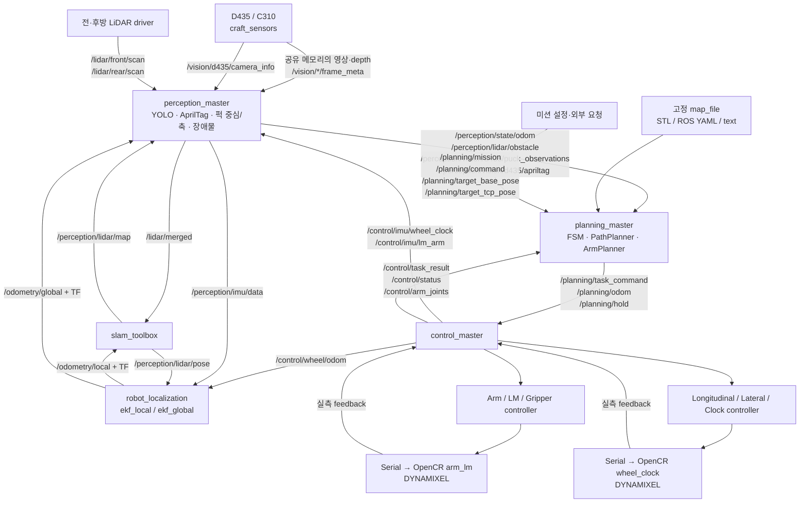
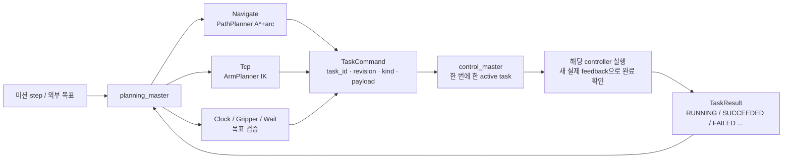
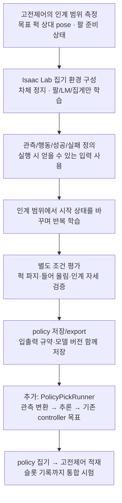
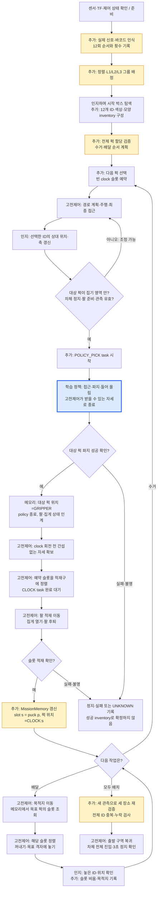
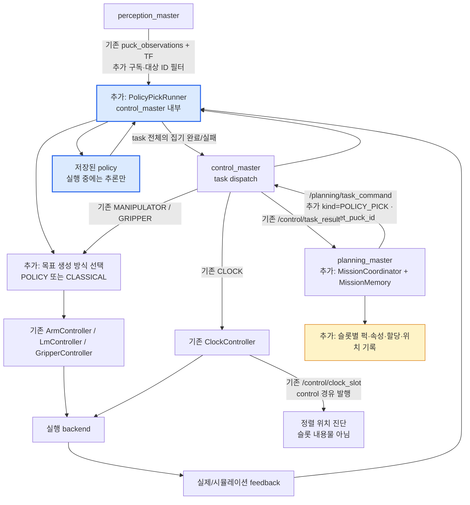
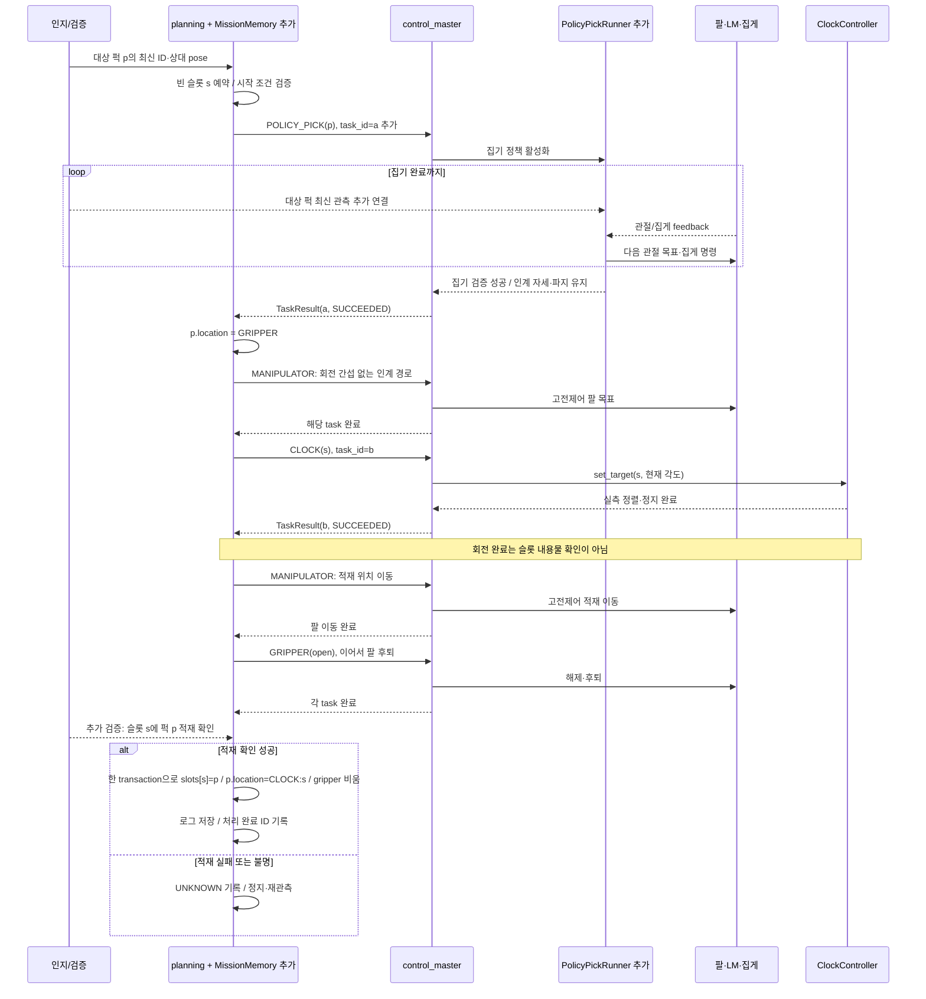
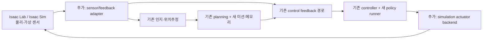

# CRAFT 전체 흐름: 인지·판단·제어와 학습 집기·clock inventory

기준: 2026-11-02 현재 working tree. 소스와 설정을 읽어 확인한 구조다. 실행 코드는 수정하거나 실행하지 않았다. 아래의 ‘현재’는 확인된 구현, ‘추가’는 제안이며 신규 이름은 확정 API가 아니다. 외부 라이브러리 전체 내부나 모든 분기의 정합성을 검증한 감사 보고서는 아니다.

결론: 인지와 미션 판단은 기존 코드가 맡고, 상자 위 퍽 집기만 정책으로 실행한 뒤 기존 clock/팔/집게 코드로 적재할 수 있다. 슬롯별 내용물은 상위 MissionMemory에 저장한다. 현재 clock 회전 기능은 있으나 inventory와 policy executor는 없다.

## 1. 현재 실제 노드·토픽 흐름

기본 `craft.launch.py`의 localization:=ekf, lidar_input_mode:=raw 기준. 내부 모듈을 모두 별도 ROS 노드로 그리지 않았다.



Camera 영상은 현재 DDS Image 구독이 주 경로가 아니라 공유 메모리+frame_meta이다. C310은 현재 주로 기존 knob/lever 인식 경로이며 이번 미션 신호 decoder가 자동으로 존재하는 것은 아니다.

`localization:=slam`이면 ekf_global 대신 slam_toolbox가 map→odom을 소유하고 perception은 /odometry/local을 TF로 map에 변환한다. `lidar_odom:=true`이면 perception의 /perception/lidar/odom이 EKF의 추가 입력이다. 현재 planning은 SLAM /map을 직접 구독해 전역 지도를 갱신하지 않고 시작 시 로드한 map_file을 사용한다. 인지의 동적 장애물은 별도 반영한다.

## 2. 현재 task dispatch와 완료 판정



현재 kind는 NAVIGATE, MANIPULATOR, GRIPPER, CLOCK, WAIT뿐이다. EXECUTE는 동일 task_id에 대해 재실행하지 않는다. UPDATE_PATH는 실행 중 NAVIGATE에만 허용된다. 실행 중 새 MANIPULATOR task를 빠르게 발행하면 busy로 거부되므로, 이 방식으로 policy action stream을 구현할 수 없다. TaskResult는 반복 발행하므로 메모리 변경은 task/transaction ID로 중복 적용을 막아야 한다.

planning FSM은 Idle→Ready→Run.AwaitRequest→PrepareTask→Compute→Execute→Complete다. hold/watchdog/fault는 모든 축에 적용된다. `/planning/hold=true`는 ‘차체만 정지’가 아니므로 policy 집기를 켜면서 true로 보내면 안 된다. 집기 task 안에서 wheel 목표 0, clock 위치 유지로 제어한다.

## 3. 학습부터 전체 미션 연결까지



출력이 관절 목표라면 집기 구간의 IK/고정 waypoint 생성을 대체한다. ArmController/LmController의 단위·영점 변환과 모터 PID는 유지한다. 정책은 clock_slot이나 퍽 할당을 결정하지 않는다. 성공은 ‘잡아 들기’와 함께 고전제어 적재가 시작 가능한 종료 자세 및 파지 상태까지 만족해야 한다. 관절 자세가 같아도 집게 안 퍽의 위치·방향이 크게 다르면 기존 적재 경로가 맞지 않을 수 있다.

관측에 joint velocity·gripper angle/current가 필요하다면 feedback 인터페이스 확장이 필요하다. 현재 /control/arm_joints는 5개 관절 position만 넣고, gripper current/angle은 control 내부에 있으며 공개된 /control/gripper_grasped는 Bool 추정값이다.

## 4. 제안하는 전체 미션 흐름

주황색은 새 미션 기능, 파란색만 학습 정책이다. 기존 기반 기능이 있어도 아래 전체 미션이 현재 구현됐다는 뜻은 아니다.



실제 시작 박스들을 돌아야 12개를 등록할 수 있으면 탐색/관측 주행을 먼저 수행하고, 전체 할당을 확정한 뒤 수거한다. 이중 방문을 줄이는 계획은 별도 최적화다. 전량 수거 후 배달과 중간 배달 중 어떤 순서를 쓸지는 저장·운반 가능성에 따라 정한다.

상자 위 집기만 정책의 책임으로 했으므로 clock에서 꺼내기와 목적지 놓기는 고전제어다. 학습한 상자 집기 정책을 clock 꺼내기에 자동 재사용할 수 있다고 가정하지 않는다.

현재 `check_pucks()`는 가장 가까운 퍽을 기준으로 diagnostics를 갱신한다. 정책 시작 조건은 이를 그대로 쓰지 말고 **미션에서 선택한 target_puck_id**에 대해 TF·freshness·연속 확인을 수행해야 한다. 현재 영역 값도 0이므로 실측 입력 전에는 유효 시작 조건으로 쓸 수 없다.

## 5. 정책을 끼워 넣을 위치: 제안 아키텍처

기존 control_master 내부에 PolicyPickRunner를 추가하는 안이다. 별도 ROS 노드로 나눌 수도 있으나 현재 단일 active task 구조에는 이 구성이 단순하다.



POLICY_PICK를 추가하려면 interfaces, StepKind, YAML parser, planning readiness/compute/dispatch, control validation/dispatch와 TaskTracker 완료 규칙을 함께 확장해야 한다. 현 코드의 kind 숫자 mapping도 맞춘다. 제안 이름을 publish하는 것만으로 현재 코드가 이해하지는 않는다.

POLICY_PICK의 controller matrix는 Arm·LM·Gripper를 참가자로 두고, 목표 하나의 도달 여부가 아니라 집기 단계 전체가 성공했을 때 완료한다. wheel 0·clock hold·관측 stale·추론 deadline·STOP/watchdog를 같은 control 경로에서 처리한다. 정책 종료 때 닫힌 집게와 마지막 팔 목표를 고전제어로 명시적으로 인계한다. 다음 명령은 CLOCK 등 새 task이고, 그때는 policy가 더 이상 팔 목표를 덮어쓰지 않는다.

## 6. 정책 집기 → 고전 clock 적재 → 메모리 확정



현재 `demo/puck_pick/execute.py`의 `load_tail()`은 LM 적재 라인→CLOCK→팔 적재 자세→집게 열기→팔 후퇴를 이미 수행한다. 단 LOAD_SLOT=12로 고정되어 있고 inventory 갱신은 없다. 일반적인 다슬롯 처리와 새 정책 종료 자세에 맞춘 연결 경로는 추가·검증해야 한다. 데모는 planning_master를 거치지 않고 /planning/task_command와 /planning/hold를 직접 발행하므로 전체 시스템과 동시에 명령 권한을 가지게 하면 안 된다.

## 7. 슬롯 메모리의 의미

`clock`은 회전형 12-slot 저장장치다. ROS 시뮬레이션 시간 `/clock`과는 다른 개념이다.

| 값 | 의미 | 현재 상태 |
|---|---|---|
| /control/clock_slot | 지금 적재구에 정렬된 물리 슬롯 번호. 미정렬/무효이면 0 | 있음 |
| /control/clock_target_reached | 명령한 clock 회전 목표 도달 추정 | 있음 |
| TaskResult CLOCK 성공 | 해당 task ID에 대응한 회전·정지 완료 | 있음 |
| slots[s].puck_id | 물리 슬롯 s 안에 든 퍽 ID | 추가 필요 |
| puck[p].color / shape | 이번 회차에 등록/관측한 실제 속성 | 추가 필요 |
| puck[p].location | SOURCE / GRIPPER / CLOCK:s / DESTINATION / UNKNOWN | 추가 필요 |
| target_group / destination / grid_cell | 전체 할당 계획 | 추가 필요 |

예시(제안 데이터, 실제 속성/ID 대응이 아님):

```json
{
  "slots": {
    "3": {"state": "OCCUPIED", "puck_id": 7, "transaction_id": "load-42"}
  },
  "pucks": {
    "7": {
      "color": "red",
      "shape": "cylinder",
      "location": "CLOCK:3",
      "destination": "L2",
      "grid_cell": [1, 0]
    }
  },
  "gripper_puck_id": null
}
```

3번 슬롯을 돌려 다른 위치에 보내도 puck 7의 물리 슬롯은 3번이다. ‘현재 적재구에 보이는 슬롯’과 ‘슬롯별 내용물’은 별개의 값이다. 꺼낼 때는 puck 7→slot 3 조회→CLOCK(3)→꺼내기 검증→GRIPPER로 이동 기록→목적지에 놓기 검증 순서다. 회전만으로 슬롯 메모리를 비우거나 재번호하지 않는다.

예약은 적재 성공이 아니다. reserve→transfer pending→verified commit을 구분하고, 퍽이 실제로 손을 떠났는데 적재 확인이 안 되면 위치를 UNKNOWN으로 남긴다. 전류 Bool 하나는 정확한 slot/ID 확인 센서가 아니다. 슬롯 카메라·재관측 등 근거를 설계해야 한다. simulator의 ground truth로 확인한다면 그 결과는 시뮬레이션 검증으로 명시한다.

MissionMemory는 planning 계층의 한 모듈/한 작성자가 관리하는 구성이 적합하다. 신경망의 hidden state에 slot inventory를 저장하지 않는다. 메모리와 event log를 함께 관리하고 재시작 시 물리 상태와 대조한다. 로그를 읽었다고 실제 적재 상태를 자동 확정하지 않는다.

## 8. Isaac Lab에서 실행할 때 필요한 연결



현재 launch는 실제 카메라와 serial OpenCR backend 및 use_sim_time=False를 사용한다. simulator에 자동 연결된 구성은 아니다. serial 부분을 simulator feedback/actuator adapter로 대체하거나, 상위 interface를 유지하는 simulation용 control 구현이 필요하다. 카메라 입력도 현재 공유 메모리/frame_meta 규약을 맞추거나 인지 입력을 확장한다. sim time 전환도 함께 구성한다. 물리 actuator와 실물 motor mapping을 중복 적용하지 않도록 단위를 명시한다.

ROS 그래프를 그대로 시험하려면 이런 adapter를 연결한다. Isaac Lab 단일 Python 프로그램으로도 동일한 분업은 가능하지만, 그것이 현재 ROS 토픽 흐름 자체의 통합 시험은 아니다.

## 확인한 주요 소스

- `src/craft_bringup/launch/craft.launch.py`: masters, sensor/SLAM/EKF wiring
- `src/craft_perception/src/perception_master.cpp`, `d435_perception.cpp`, `shared_frame.cpp`: 입력·출력·퍽 관측
- `src/craft_perception/config/ekf.yaml`: EKF 입력과 TF 소유
- `src/craft_perception/msg/PuckObservation.msg`: ID·중심·축·standing. color/shape 미포함
- `src/craft_planning/src/planning_master.cpp`: dispatch, target snapshots, nearest-puck diagnostics, FSM
- `src/craft_planning/include/craft_planning/state_machine.hpp`, `planning_config.hpp`: 현재 step 종류와 저장 정보
- `src/craft_planning/config/missions.yaml`: 현재 missions: {}
- `src/craft_interfaces/msg/TaskCommand.msg`, `TaskResult.msg`, `ControlStatus.msg`: 명령·결과 규약
- `src/craft_control/src/control_master.cpp`, `clock_controller.cpp`, `arm_controller.cpp`: 단일 task, 실측 결과, clock 정렬
- `src/craft_control/include/craft_control/task_tracker.hpp`, `planning_watchdog.hpp`: 완료 집계·watchdog
- `demo/puck_pick/execute.py`: 실제 집기·clock 적재/꺼내기 단계 실행, 슬롯 12 고정
