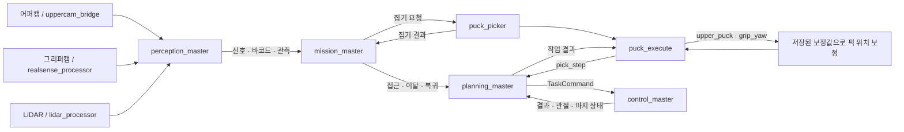
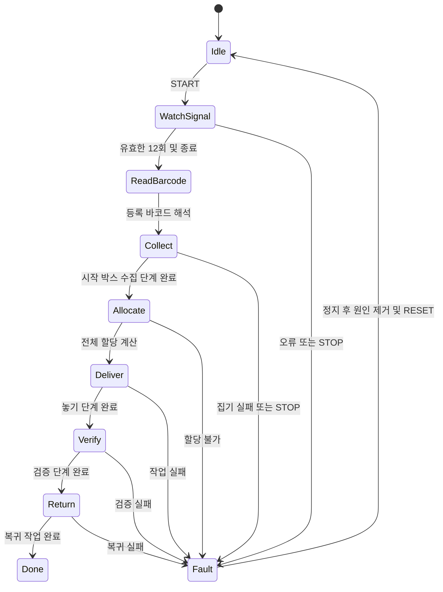

# 시스템 구조와 구현 범위

검토 소스는 `1724eec09a53c790bb9cced066fea784eadd22c9`임. 게시 직전 반영한 원격 `a732c8d`에서도 이 문서의 미션·집기 핵심 경로는 동일함. 원격 병합으로 추가된 `craft_voice`는 별도 음성 노드이며 기존 9패키지 설치본·미션 launch 연결 완료로 간주하지 않음. 구현 여부는 소스, 실물 결과는 별도 시험 로그로 판단함. 11월 16일 기록의 정확한 실행 커밋은 미확인임.

## 기능과 정보 흐름

어퍼캠은 신호·바코드와 퍽의 종류·대략적인 위치를 확인함. 그리퍼캠은 가까이 접근한 퍽의 깊이 기반 중심·바닥·프리즘 yaw를 계산함. 원기둥은 방향 보정 회전을 생략함. 집기 실행은 설치된 C++ `puck_execute` 경로이며 `demo/puck_pick/`의 Python 자료는 참조 구현임.

`craft.launch.py`의 `mission:=true`는 미션 관련 노드를 포함함. 어퍼캠 실행파일 이름은 `uppercam_bridge`, 실제 노드 이름은 `box_sensor_bridge`임. 로봇 상태 발행, EKF, 지도·위치 추정, 시각화 노드는 launch 조건에 따라 구성됨.

## 주요 인터페이스

| 경로 | 메시지 | 의미 |
| --- | --- | --- |
| `/perception/uppercam/image_raw/compressed` | `sensor_msgs/msg/CompressedImage` | 어퍼캠 압축 영상 |
| `/vision/d435/frame_meta` | `std_msgs/msg/UInt64MultiArray` | 공유 프레임 메타데이터 |
| `/vision/d435/camera_info` | `sensor_msgs/msg/CameraInfo` | 그리퍼캠 내부 파라미터 |
| `/perception/vision/uppercam/traffic_light` | `craft_perception/msg/TrafficLight` | 수락한 점멸 순서·횟수·종료·유효성 |
| `/perception/vision/uppercam/barcode` | `std_msgs/msg/String` | 해석한 바코드 |
| `/perception/vision/d435/puck_survey` | `craft_perception/msg/PuckSurvey` | 퍽 조사 결과 |
| `/mission/command`, `/mission/state` | `std_msgs/msg/String` | 미션 명령·상태 |
| `/mission/pick_request`, `/mission/pick_cancel`, `/mission/pick_result` | `std_msgs/msg/String` | 집기 요청 토큰·박스·슬롯·모드와 결과 |
| `/planning/pick_step` | `craft_interfaces/msg/TaskCommand` | 집기 실행기의 단계 명령 |
| `/planning/pick_step_result` | `craft_interfaces/msg/TaskResult` | 단계 완료·실패 결과 |
| `/planning/task_command` | `craft_interfaces/msg/TaskCommand` | 제어기로 전달할 작업 |
| `/control/task_result`, `/control/status` | `TaskResult`, `ControlStatus` | 제어 작업 결과·상태 |
| `/control/arm_joints`, `/control/gripper_grasped` | `sensor_msgs/msg/JointState`, `std_msgs/msg/Bool` | 관절 상태·파지 판정 |
| `/planning/approach_box`, `/planning/leave_box`, `/planning/state` | `std_msgs/msg/String` | 박스 접근·이탈·계획 상태 |
| `/planning/target_base_pose` | `geometry_msgs/msg/PoseStamped` | 복귀 등의 베이스 목표 |
| `/planning/box_observation_request` | `craft_interfaces/msg/BoxObservationRequest` | 박스 관측 요청 |
| `/perception/box/observation`, `/perception/uppercam/observation` | `craft_interfaces/msg/BoxObservation` | 박스 관측 응답 |

집기 카메라 사용 시 `/perception/uppercam/pick_pause`·`pick_paused`, `/vision/d435/pick_pause`·`pick_paused`의 Bool 교환으로 카메라 사용을 조정함. 일반 인지 경로와 집기 도구의 카메라 접근을 구분해야 함.

## 좌표계와 단위

| 대상 | 기준·단위 | 주의점 |
| --- | --- | --- |
| 문제·정답 | 맵 기준 mm, 바닥 Z=0 | 퍽 바닥 좌표는 TCP 목표와 다름 |
| 주행 설정 | 맵 x/y는 m, YAML yaw는 deg | 목표 메시지의 방향은 quaternion임 |
| 로봇 | x 정면, y 좌측 | +y는 LM 모터 반대쪽, slide − 방향임 |
| 카메라 집기 도구 | 중심·오프셋 mm, yaw deg | 카메라 좌표·로봇 좌표·보정값을 혼용하지 않음 |
| 관절 | 회전 rad, LM m | 티칭값·보정값이 적용됨 |
| 미션 배치 계획의 `spot` | 격자 인덱스 | 그대로 mm 좌표로 사용하지 않음 |

`planning/pick_step`의 NAVIGATE에서 `speed`에 쓰는 특수 값은 일반 속도와 다른 계약임. 음수는 후진 거리(m), 0은 같은 박스 재도킹을 의미함. 누운 퍽의 기본 후진 거리 0.28 m는 시나리오 값이며 모든 경기 경로에 일괄 적용하는 값이 아님.

## 현재 상태 전이와 완료 조건

위 상태도는 코드의 구조임. 아래 미구현 조건 때문에 상태 진행 자체를 실물 성공으로 판단하면 안 됨. 모든 실행 중 단계에서 오류·사용자 STOP은 Fault 처리 대상임.

| 단계 | 현재 구현 | 제출 시 인정 범위 |
| --- | --- | --- |
| WatchSignal / ReadBarcode | 관측·횟수·바코드 처리 연결됨 | 운영자 정답과 원본 관측을 비교해야 정확도 인정 가능함 |
| 박스 접근·이탈 | planning 작업과 완료 상태 연결됨 | 실제 이동 결과는 시험별 근거 필요함 |
| ObservePucks | 0.5초 경과 후 성공 처리하는 skeleton | 12개 ID·속성 등록 성공으로 인정할 수 없음 |
| PickPuck | puck_picker → puck_execute → planning 경로 연결됨 | 개발 시험에서 5회 완료 로그와 1회 실패 확인됨 |
| Allocate | 할당 로직은 있으나 수집 이후 실행함 | 문제지의 전체 할당 선행 흐름과 차이가 있음 |
| PlacePuck | 시간 경과 성공 처리하는 skeleton | 목적지 배치 미구현임 |
| VerifyLocation | 시간 경과 성공 처리하는 skeleton | 새 관측 검증 미구현임 |
| Return | 주행 목표 전달 경로 있음 | 차체 전체 구역 진입·3초 정지 성공 근거는 별도 필요함 |

`mission.yaml`의 기본값은 `drive_only: true`, `assume_unknown_picks: true`임. 주행 모드는 관측·집기·배치·검증·할당을 생략하며, 미확인 퍽을 가정하는 설정은 실제 ID·속성 검증을 대신하지 못함. 문제지의 기대 흐름은 관측→전체 할당→주행·조작→새 관측 검증→복귀임. 이 차이를 현재 완료 기능처럼 작성하지 않음.

## 오류 처리

실패 시 미션은 Fault로 전이하고 집기 취소 및 planning STOP을 전달함. 실행 중 START는 중복 시작하지 않으며, 실행 중 RESET은 무시됨. STOP 후 미션 RESET은 미션 상태만 초기화하고 planning의 Fault까지 초기화하지 않으므로 별도 RESET이 필요함. 사용자 실행 명령은 [README](../README.md)에 있음.

소스 근거: [launch](../../src/craft_bringup/launch/craft.launch.py), [mission_master](../../src/craft_planning/src/mission_master.cpp), [미션 설정](../../src/craft_planning/config/mission.yaml), [계획 설정](../../src/craft_planning/config/planning.yaml). 코드 수정·실물 구동은 이번 자료 정리 범위에 포함하지 않음.
