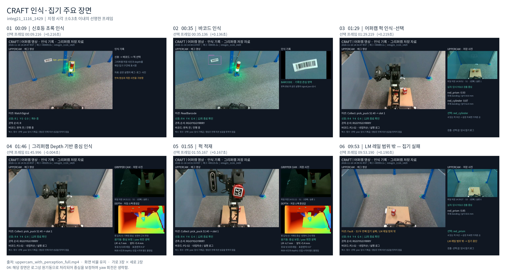

# 개발 시험 보고서 — integ21_1116_1429

2026-11-16 실물 개발 시험의 인식·집기 과정을 정리함. 로그상 집기 5회 완료 후 S3의 두 번째 퍽을 선택하는 단계에서 LM 레일 범위 초과로 중단됨. 공식 경기 여부와 당시 정확한 코드 커밋·파라미터 사본은 미확인임.

## 보고서용 이미지

원본 전체 영상의 지정 시각 ±0.3초 안에서 선택한 프레임임. 가로 3장 × 세로 2장, 3040×1628 px 이미지이며 시간 선택 근거는 [selected-frames.json](assets/selected-frames.json)에 있음.

| 순서 | 영상 시각 | 의미 | 확인 가능한 내용 |
| --- | --- | --- | --- |
| 1 | 00:09.216 | 신호등 인식 | 어퍼캠에서 초록 신호를 인식한 화면임 |
| 2 | 00:35.136 | 바코드 해석 | 바코드 관측 화면과 실행 기록을 함께 제시함 |
| 3 | 01:29.219 | 퍽 선택 | 어퍼캠에서 퍽 종류·위치를 추출하는 과정임 |
| 4 | 01:45.996 | 근거리 중심 보정 | 저장된 그리퍼캠 RGB·깊이 자료를 합성한 설명 화면임 |
| 5 | 01:55.167 | 집기·적재 과정 | 해당 시점의 수행 화면임. 한 장으로 최종 슬롯 상태를 검증하지 않음 |
| 6 | 09:53.190 | 실패 원인 | LM 레일 범위 밖으로 판정하여 중단한 기록임 |

전체 영상은 배그의 어퍼캠에 신호·상태 로그와 같은 실행의 저장 사진·깊이 자료를 덧붙인 설명 영상임. 배그에는 그리퍼캠 연속 영상·depth·yaw 토픽이 없음. 보조 사진은 인접한 시각의 단발 촬영이며 카메라 간 동기 영상으로 해석하지 않음. 오버레이의 모든 값이 원본 카메라 화면에 직접 기록된 것은 아님.

특히 4번은 원기둥을 다룬 장면으로 yaw 회전이 생략됨. 따라서 **Depth 기반 중심 인식**이라고 표기함. 프리즘 yaw 계산 근거는 S1 두 번째 집기 로그의 −22.7°(보정 후 −24.2°), S3 첫 번째의 +5.2°(보정 후 +8.9°)임.

## 적용 기능과 시험 결과

어퍼캠의 YOLO 계열 퍽 인식 결과에서 종류·신뢰도·픽셀 위치·로봇 기준 위치를 얻고, 선택한 퍽에 대해 그리퍼캠의 깊이 기반 중심과 프리즘 방향을 계산함. 모델·코드 경로의 설명은 [시스템 구조](architecture.md), 해당 실행의 값은 [pick-results.csv](../results/development/integ21_1116_1429/pick-results.csv)에 연결함.

| 단계 | 기록 | 판단 |
| --- | --- | --- |
| 신호 | RGGYYGGYRRRY, R4·Y4·G4 및 종료 이벤트 | 출력 생성 확인됨. 운영자가 제시한 독립 정답이 없어 정확도 미확인임 |
| 바코드 | 미션 저장값 P2-02 / descending | 저장값과 상태 전이 확인됨. 원시 barcode 토픽은 배그에 없음 |
| 그룹 | 동률 순서로 L1 R4, L2 Y4, L3 G4 | 그룹 계산 기록이며 12개 ID 전체 할당 기록은 아님 |
| S1·S2·S3 첫 번째 | 집기 5회 완료 로그 | 실행 단계 완료 근거임. 슬롯별 새 관측 검증은 없음 |
| S3 두 번째 | `FAILED upper cam: puck is past the LM rail` | 6번째 집기 실패, Collect→Fault 확인됨 |
| 목적지 배치·재검증·복귀 | 이 실행에 성공 기록 없음 | 수행 완료로 인정하지 않음 |

신호 처리에서 유효한 12회 결과를 저장했다는 사실과 12회의 실제 색상을 모두 정확히 맞혔다는 주장은 다름. 별도 운영 정답이 없으므로 인식 정확도나 경기 점수를 산출하지 않음.

## 실패 내용과 남은 확인

실패한 퍽은 `red_prism`, 신뢰도 0.85, 어퍼캠 추정 ahead 121.7 mm / lateral 44.8 mm로 기록됨. 로그의 보정 이후 목표가 LM 도달 범위를 벗어나 집기가 중단됨. 이 기록만으로 기계 한계, 도킹 오차, 보정값 중 어느 것이 근본 원인인지 확정하지 않음. 범위를 임의로 확대하지 않았음.

현재 미션의 장소 배치·새 관측 검증은 미구현임. 해당 실행 역시 수집 단계에서 끝났으므로 전체 미션의 성공을 증명하지 못함. 실패 회차를 제외하거나 성공 장면만 합쳐 완주 결과로 제시하지 않음.

## 근거와 접근 범위

- [원본 미션 로그](../results/development/integ21_1116_1429/mission.log), [원본 신호 저장값](../results/development/integ21_1116_1429/original-signal.json), [집기 원본 로그](../results/development/integ21_1116_1429/picks/)를 수록함.
- [신호 이벤트](../results/development/integ21_1116_1429/signal-events.csv)와 [미션 상태 이벤트](../results/development/integ21_1116_1429/state-events.csv)는 배그에서 읽어 추출한 기록임. 실제 장비 재실행은 하지 않았음.
- [영상 목록](../results/development/integ21_1116_1429/video-manifest.json)은 전체 96분 43초 영상과 약 3분 32초 하이라이트의 원본 위치·해시를 기록함. 공개 URL은 아직 없음.
- 공식 회차, 개인별 수행자, 시험 당시 커밋·설정, 배치 정답, 새 관측 검증, 다른 팀원의 재현 실행은 추가 근거가 필요함.
